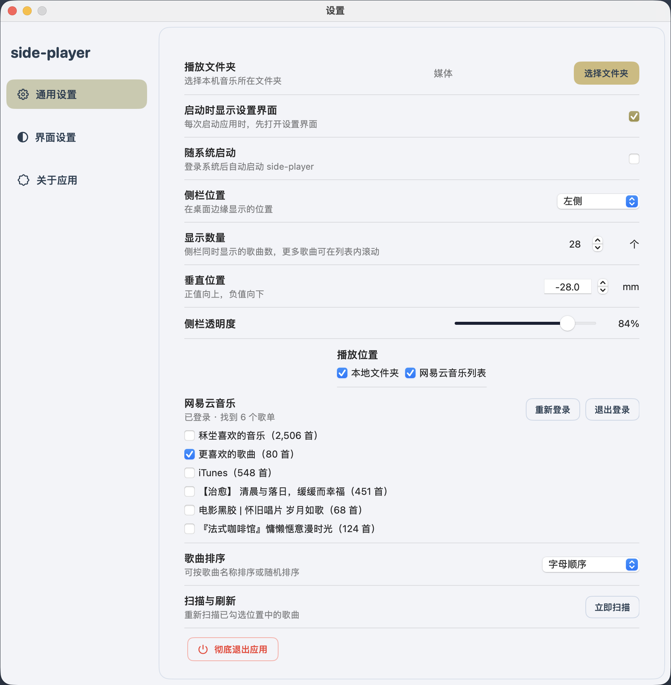
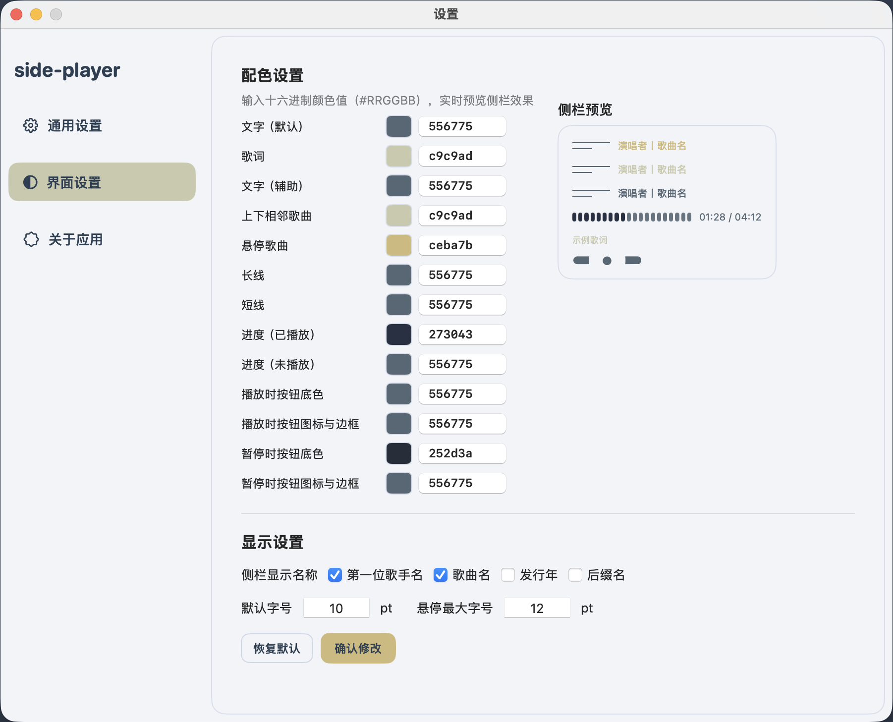
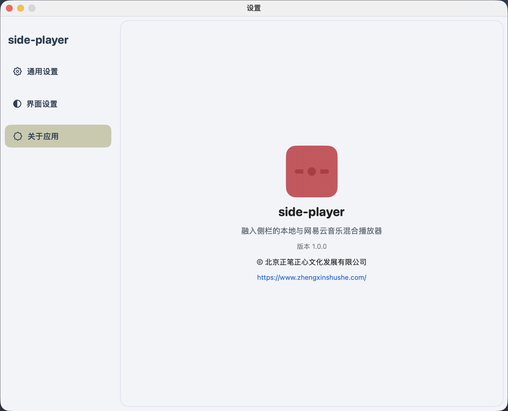
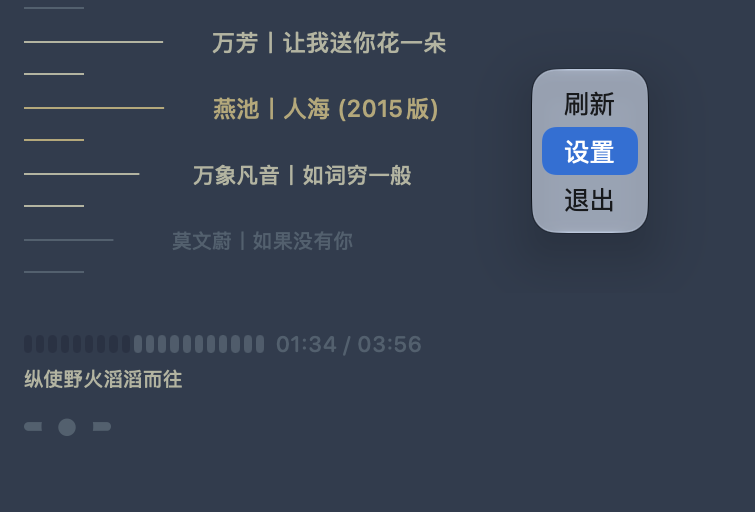

# side-player

## 1、功能

side-player 是一款 macOS 桌面侧栏音乐播放器，可将本地音乐与网易云音乐放在同一列表中播放。

side-player 适合优雅安静的呆在纯色的桌面上。

side-player 支持 macOS 14 或更高版本，发布包为 Universal，可用于 Apple Silicon 与 Intel Mac。当前发布包尚未使用 Developer ID 签名或公证。首次打开时，如果 macOS 阻止启动，请在“系统设置 → 隐私与安全性”中确认是否允许打开。

## 2、设置

设置窗口分为“通用设置”“界面设置”和“关于应用”。

### 通用设置

可以选择本地音乐文件夹，设置启动时是否显示设置界面、是否随系统启动、侧栏位置、显示歌曲数量、垂直位置和侧栏透明度。

默认本地音乐文件夹为 macOS 音乐资料库的媒体目录，也可以在设置中选择其他文件夹。

侧栏同时显示的歌曲数量可调节，更多歌曲可在列表内滚动查看。

“播放位置”可分别启用本地文件夹与网易云音乐列表。

登录网易云音乐后，可选择要加入侧栏的歌单。

歌曲支持按名称排序或随机排序。

### 界面设置

可分别调整文字、歌词、相邻歌曲、悬停歌曲、长短线、播放进度和播放控制按钮的颜色，并在侧栏预览中查看效果。

还可设置侧栏歌曲名称是否显示歌手、歌曲名、发行年和后缀名，以及默认字号与悬停时的最大字号。

### 关于应用

显示 side-player 图标、应用简介、版本、版权信息和官网链接。

## 3、授权

首次选择本地音乐文件夹时，请在 macOS 文件选择窗口中选取音乐所在目录。

网易云音乐歌单需要先登录账号。登录后，side-player 会读取账号可访问的歌单；退出登录可在“通用设置”中操作。

## 4、操作

- **播放歌曲：** 点击侧栏中的歌曲开始播放。
- **播放控制：** 使用进度条下方的上一首、播放/暂停和下一首按钮控制播放；点击进度条可跳转到对应位置。
- **查看歌词：** 当前歌词显示在进度条和时间下方；本地歌曲读取同目录下的 LRC 歌词，网易云音乐歌曲读取在线歌词。
- **使用本地音乐：** 在“通用设置”中选择音乐文件夹并启用“本地文件夹”。支持 MP3、M4A、AAC、ALAC、WAV、AIFF、FLAC、APE、WV、OGG、Opus 和 NCM 等格式。
- **使用网易云音乐：** 登录后勾选歌单，歌曲便会加入侧栏列表。播放时优先请求可用的无损 FLAC 音源；账号或歌曲不提供时，改用可用的 MP3 音源。
- **刷新、设置或退出：** 在侧栏右键单击，或点击菜单栏中的 side-player 图标，可选择“刷新”“设置”或“退出”。

